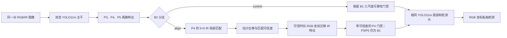
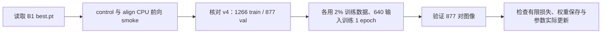

# B2 `align` 对照实验：本地检查与服务器正式训练

> 2026-10-22。目标是检验“P4 局部 IR→RGB 对齐及其可信度，能否改善雾/低能见度船舶检测”。这是一项待验证假设；本地 debug 结果只说明程序可运行。

## 1. 看懂实验结构



- **相同起点**：两组均重新从服务器原 `runs/b1_s42/weights/best.pt` 初始化，不能从已经训练过的 B2 权重接着跑。
- **唯一模型差异**：`control` 保留 B1；`align` 将 P4 融合块改为局部匹配、IR→RGB 迁移和匹配可信度引导的 B1 门控。P3/P5 不变。
- **相同训练机会**：seed 42、v4 数据、960 输入、batch 2、优化器和增强一致，均固定训练 **100 epoch**，`patience=100`；比较各自 `best.pt`。
- **共同真值**：仍使用 RGB 坐标标注。v4 只改了 28 个 RGB 验证标签；训练图像、训练标签和 train/val 划分与 v3 相同。

## 2. 本地已运行的检查

本地环境：`D:\anaconda3\envs\yolo\python.exe`，`ultralytics 8.3.163`，RTX 5060。运行脚本：[`fog_ship_code_20261019/run_align_local.ps1`](fog_ship_code_20261019/run_align_local.ps1)。它依次执行：



手动复现的 PowerShell 命令（在本机运行，不在服务器运行）：

```powershell
Set-Location 'E:\HEU_4151\RGB_IR'
& '.\fog_ship_code_20261019\run_align_local.ps1' -Mode all
```

本次实际运行已通过：两组 CPU 前向、v4 清单、1 epoch 训练、877 对验证、有限损失、检查点保存和参数更新检查。以下只是 **640 输入＋2% 训练数据＋1 epoch** 的调试数字：

| debug | 全验证集 AP50–95 | 召回率 |
| --- | ---: | ---: |
| control | 0.65068 | 0.80182 |
| align | 0.65067 | 0.79725 |

两组 AP 几乎相同；这不能判断正式对齐实验是否有效。

只重做 CPU 前向：`-Mode smoke`。若要重做完整 debug，请加一个新的 `-OutputRoot`，脚本不会覆盖已有结果。输出位于 [`align_local_debug_20261022`](align_local_debug_20261022/)；其中的 640 输入、2% 训练数据和单轮指标**不能与正式 960/100 轮结果比较**。

可直接查看本地输出的示例图：


这两幅图仅供检查数据流和预测可视化，不用于判断模块最终有效性。`ir/val_batch*_labels.jpg` 叠加的是 **RGB 坐标真值**，不要把它当作 IR 原生标签图。

## 3. 上传到服务器：只传 28 个标签补丁

服务器既有目录按之前实验使用：`/work/home/kekexiong/fog_ship_code_20261019`。**无需重传本机约 1 GB 的 v4 图像目录。**v4 与服务器 v3 的图像、训练标签、配对清单和划分相同；只有 28 个 RGB 验证标签不同。本地已生成 [`label_corrections_v4`](fog_ship_code_20261019/label_corrections_v4/)：28 个 TXT 与旧/新 SHA-256 清单。服务器准备脚本会以原有 v3 为源，硬链接图像（不支持时复制），独立复制全部标签，再应用并校验这 28 个补丁；**不会修改服务器 v3**。

| 本机文件 | 服务器位置 |
| --- | --- |
| `fog_ship_code_20261019/label_corrections_v4` 整个目录（28 个 TXT＋`manifest.json`） | `/work/home/kekexiong/fog_ship_code_20261019/label_corrections_v4` |
| `fog_ship_code_20261019/server_submit_b2_align_v4.sh` | `/work/home/kekexiong/fog_ship_code_20261019/` |
| `prepare_v4_from_v3.py`、`run_b2.py`、`b2_variants.py`、`rgb_ir_midfusion.py`、`fog_reliability.py`、`prepare_data.py`、`eval_groups.py`、`eval_shift.py` | 同名文件放入服务器代码目录 |
| `fog_ship_code_20261019/val_conditions_reviewed.csv` | 同名文件放入服务器代码目录 |

服务器上原有的 `runs/b1_s42/weights/best.pt` 是 B2 的初始化，不必重新上传。如果服务器上找不到它，先从本机 [`B1 best.pt`](fog_ship_experiments_20261019/runs/b1_s42/weights/best.pt)补传到同一路径。

**Windows PowerShell 上传示例**（在本机执行；把 `USER@HOST` 换成实际账户和地址）：

```powershell
$remote = 'USER@HOST'
ssh $remote 'mkdir -p /work/home/kekexiong/fog_ship_code_20261019'
$code = 'E:\HEU_4151\RGB_IR\fog_ship_code_20261019'
scp -r (Join-Path $code 'label_corrections_v4') "${remote}:/work/home/kekexiong/fog_ship_code_20261019/"
$files = @('server_submit_b2_align_v4.sh','prepare_v4_from_v3.py','run_b2.py','b2_variants.py','rgb_ir_midfusion.py','fog_reliability.py','prepare_data.py','eval_groups.py','eval_shift.py','val_conditions_reviewed.csv')
foreach ($file in $files) { scp (Join-Path $code $file) "${remote}:/work/home/kekexiong/fog_ship_code_20261019/" }
```

先确认服务器原有 `/work/home/kekexiong/datasets/MTDSP_v3_labelreview_20261020/dataset/pairs.csv` 存在。若实际路径不同，运行 `prepare` 前设置 `V3_DATA_ROOT=实际v3路径`。`prepare` 会构建新的服务器 v4 目录并生成**服务器绝对路径**的数据清单，不会使用本地 YAML 中的 Windows 路径。本地已实际重建一次：4294 份标签与本机最终 v4 逐文件一致，配对清单也一致。

## 4. 服务器正式训练与评估

以下命令均在**服务器终端**执行。先激活之前 B1 使用的 `pt206_cu124_py311` Python 环境，并进入代码目录：

```bash
cd /work/home/kekexiong/fog_ship_code_20261019
python -c 'import torch, ultralytics; print(torch.__version__, ultralytics.__version__)'
bash server_submit_b2_align_v4.sh prepare
```

`prepare` 应打印 `1266 train, 877 val`；它也检查 877 条条件分类是否完整。若服务器 Slurm 分区不是 `xhhgnormal02`，提交时设置 `PARTITION=实际分区名`。正式提交同一 seed 的两组：

```bash
bash server_submit_b2_align_v4.sh submit train control 42
bash server_submit_b2_align_v4.sh submit train align 42
squeue -u "$USER"
```

两组结果分别存放在 `runs_align_v4/b2_control_fixed100_s42/` 与 `runs_align_v4/b2_align_fixed100_s42/`。查看 `slurm-alignv4_train_*-作业号.out` 日志；完成后检查：

```bash
bash server_submit_b2_align_v4.sh status 42
```

`status` 应显示两组各 **100 epoch**、最佳轮次及最佳 AP50–95。之后提交三类**仅评估、不训练**的作业：

```bash
bash server_submit_b2_align_v4.sh submit val control 42
bash server_submit_b2_align_v4.sh submit val align 42
bash server_submit_b2_align_v4.sh submit groups control 42
bash server_submit_b2_align_v4.sh submit groups align 42
bash server_submit_b2_align_v4.sh submit shift control 42
bash server_submit_b2_align_v4.sh submit shift align 42
```

输出位置：

| 输出 | 文件 | 解释 |
| --- | --- | --- |
| 全验证集 | `runs_align_v4/*/results.csv`、`eval_align_v4/b2_*/` | 总体 AP、召回率和最佳轮次 |
| 雾/清分组 | `eval_align_v4/groups_*/group_metrics.csv` | 主要看雾组 AP50–95 与召回率，同时检查清晰组 |
| 人工 IR 平移 | `eval_align_v4/shift_*/shift_metrics.csv` | 固定 RGB 图与 RGB 真值，仅把 IR 向右平移 0/4/8/16 输入像素；比较性能随错位增加的变化 |

`shift` 是**受控错位压力测试**，只覆盖向右平移，不代表真实配准误差分布。若 control/align 差距很小或方向不一致，应扩展为双向位移和真实错位样本复核，不直接宣称“对齐有效”。

## 5. 如何判读结果与下一步

1. **先比较 `align − control`，不要只与旧 B1 数字比。**两组是同一 B1 起点、同一 v4 数据、相同 100 轮训练机会。
2. 主要证据是雾组 **AP50–95、召回率**；同时看清晰组是否退化。只有 AP50–95 略涨、召回明显降，不能解释为“雾中船检得更多”。
3. 检查 0/4/8/16 像素错位曲线：若 align 的性能下降更慢，可支持受控错位鲁棒性；还需逐图核对预测是否真补回船舶，而非只改变置信度或框位置。
4. 当前只具备 seed 42 的现成 B1 权重。若第一轮值得继续，先取得 seed 43、44 的 B1 `best.pt`，再用同一脚本做配对重复；不要把同一个 seed 42 结果当成多个独立实验。
5. 633 对 `haze_fog` 与 244 对 `clear` 是人工视觉条件组，图像来自少数采集事件；要主张跨事件雾天泛化，还需独立事件测试。对齐模块只有检测损失监督，若指标变化而预测位移不可信，应再设计有已知位移真值的约束实验。

**决策**：若对齐没有可靠收益，下一阶段优先检验模态质量与目标选择性补强；若对齐在雾组和错位测试均有可重复收益，再研究“对齐可信度 × IR 目标证据 × RGB 退化程度”的选择性补强。现有 B2 `small` 的 P3 高频残差没有改善最终 v4 雾天小船召回，不建议直接照搬。
